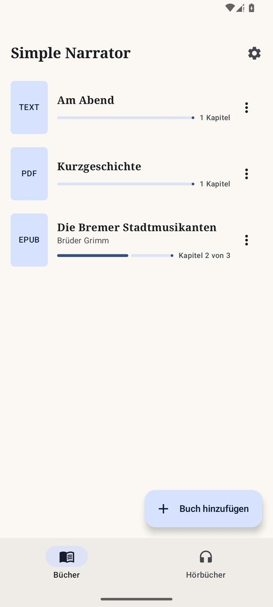
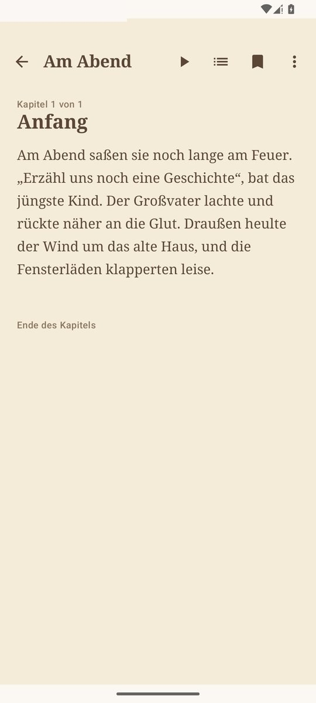
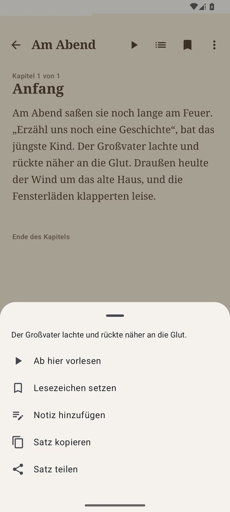
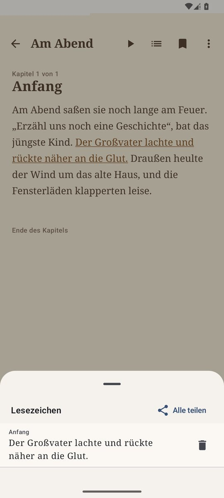
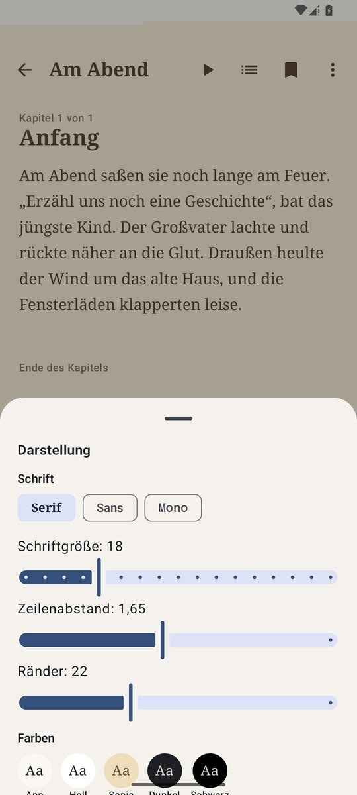
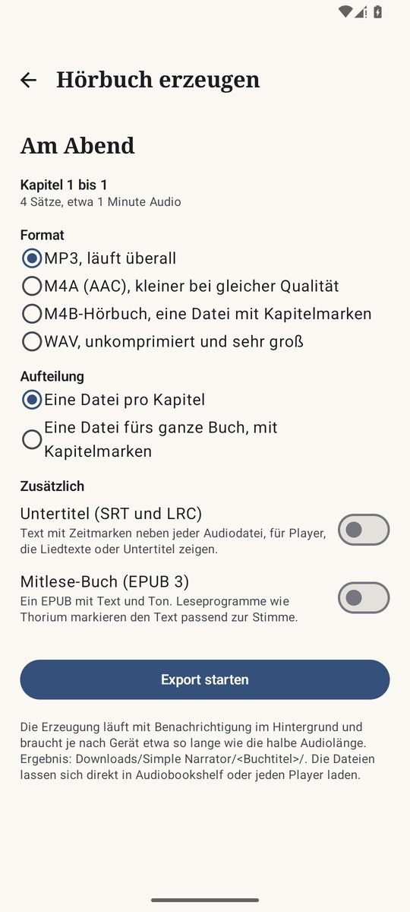
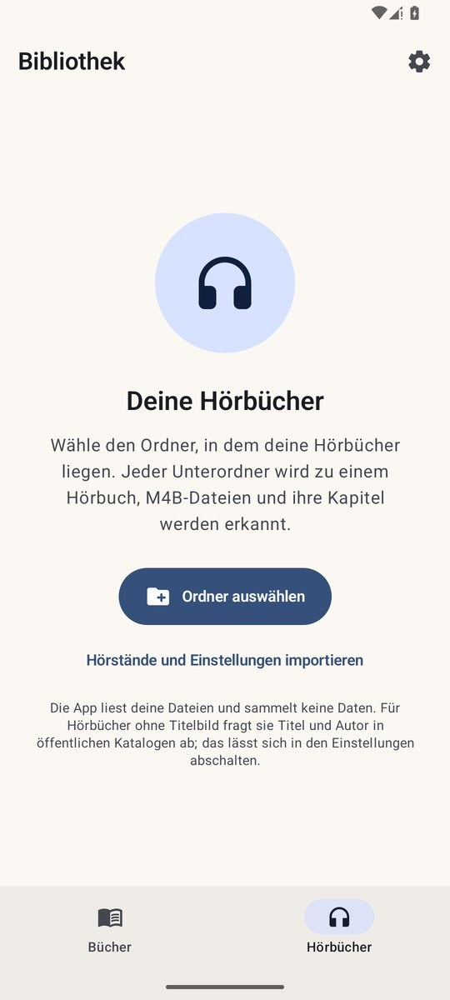
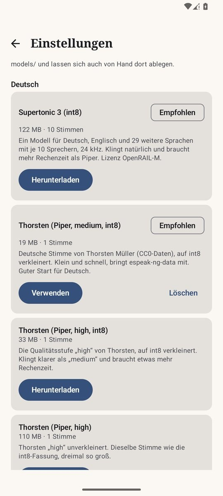

# Simple Narrator

Simple Narrator liest EPUB-, PDF- und Textdateien auf dem Android-Handy vor und spielt Hörbücher ab. Die
Stimmen (Supertonic, Kokoro, Piper und Kitten über sherpa-onnx mit ONNX Runtime und espeak-ng) laufen
vollständig auf dem Gerät: Ist eine Stimme installiert, braucht das Vorlesen weder Server noch Internet.
Ganze Bücher lassen sich als Hörbuch mit Kapitelmarken exportieren und danach im eigenen Hörbuch-Bereich
der App abspielen. Die App gibt es auf Deutsch und Englisch.

[English version](README.md)

<p><a href="https://buymeacoffee.com/regard2462"></a></p>

<p>




</p>
<p>




</p>

## Was die App kann

Die App hat zwei Bereiche, umgeschaltet mit der Leiste unten: **Bücher** (Vorlesen) und **Hörbücher** (ein
vollständiger Hörbuchplayer auf Grundlage von Simple Audiobooks).

| Bereich | Funktion |
|---|---|
| Import | EPUB (2 und 3, Cover, Inhaltsverzeichnis), PDF (Textebene, Lesezeichen werden Kapitel, Kopf- und Fußzeilen sowie Seitenzahlen werden entfernt, Silbentrennung wird aufgelöst), TXT und Markdown, eingefügter Text, Webartikel (der Haupttext wird herausgelöst), Suche in Project Gutenberg. „Öffnen mit“ und „Teilen“ aus jeder App, „Vorlesen“ im Menü einer Textauswahl. |
| Gescannte PDFs | PDFs, deren Seiten keine Textebene haben, erkennt die App auf dem Gerät mit Tesseract (Deutsch und Englisch, Sprachdaten etwa 6 MB, einmal geladen). Die Erkennung läuft im Hintergrund mit Fortschritt in der Benachrichtigung und in der Bibliothek. |
| Project Gutenberg | Suche nach Titel oder Autor mit Sprachfilter, Laden mit einem Tipp. Antwortet gutendex.com nicht innerhalb von 15 Sekunden, sucht die App im Katalog von gutenberg.org. Die Kapitel folgen dem Inhaltsverzeichnis des Buchs, auch innerhalb einer langen Datei; Vorspann und Lizenztext von Gutenberg fallen weg. |
| Lesen | Kapitelansicht und Kapitelliste, Suche im Buch, Lesezeichen und Notizen (lange auf einen Satz drücken; alle Notizen lassen sich als Text teilen), Darstellung: Schrift, Größe, Zeilenabstand, Ränder und Farben (App, hell, Sepia, dunkel, schwarz). Die Leseposition wird gespeichert. |
| Vorlesen | **Tipp auf einen Satz startet das Vorlesen genau dort.** Der aktuelle Satz und das gesprochene Wort sind markiert, die Ansicht scrollt mit. Vorausschauende Synthese (6 Sätze), Satz und Kapitel vor und zurück, Wiedergabetempo 0,8 bis 2,0× (die Tonhöhe bleibt), Schlaf-Timer (Minuten oder Kapitelende), der ausblendet und sich durch Schütteln verlängern lässt, nach mehr als 5 Minuten Pause ein Satz zurück, Lernmodus mit Halt nach jedem Satz, „Diesen Satz merken“. Läuft im Hintergrund mit Benachrichtigung, Sperrbildschirm und Bluetooth-Tasten. |
| Stimmen | Deutsch und Englisch, **pro Absatz erkannt**, gemischte Bücher wechseln die Stimme. Supertonic 3 (ein Modell für beide Sprachen, 10 Sprecher), Piper-Stimmen in int8 (Thorsten, Thorsten Emotional, Kerstin, Ramona, Eva K, Karlsson, Pavoque; Lessac, Ryan, Amy, Alan, Cori), Kokoro 1.0 mit 28 englischen Stimmen, Kokoro 0.19, Kitten nano und die deutsche Kokoro-Stimme „Martin“. Fehlt die gewählte Stimme, liest eine andere installierte Stimme derselben Sprache. |
| Wörtliche Rede | Auf Wunsch eine zweite Stimme für Text in Anführungszeichen („…“, »…«, “…”), auch über Satzgrenzen hinweg. |
| Stimmen mischen | Zwei Kokoro-Stimmen lassen sich zu einer neuen mischen (Anteil einstellbar). |
| Aussprache | Regeln mit `wort=aussprache`, regulären Ausdrücken (`*regex=ersatz`), `[skip]` und `[pause:800]`; Import aus Librera Reader und @Voice Aloud Reader. |
| Pausen und Zwischenspeicher | Einstellbare Pausen nach Sätzen, Absätzen und zwischen Kapiteln. Die Stille, die die Stimmmodelle um jeden Satz legen, wird abgeschnitten, damit die Pausen genau so lang sind wie eingestellt (Supertonic allein legt rund eine halbe Sekunde vor jeden Satz). Erzeugte Sätze bleiben in einem Zwischenspeicher mit einstellbarer Größe und werden beim Zurückspringen oder Exportieren wiederverwendet. |
| Natürliches Vorlesen | Kurze Sätze und Repliken bleiben einzeln und bekommen so jeweils ihre Pause; ein Begleitsatz bleibt bei seiner wörtlichen Rede („Lass mich rein!“ unterbrach ich.). Auslassungspunkte im Satz werden zu einem kurzen Zögern, ein Szenenwechsel („* * *“, eine Trennlinie) zu einer längeren Pause. Stottern („W-was“), Gedankenstriche ohne Leerzeichen („war—wie“) und Interjektionen, die espeak-ng buchstabieren würde („Pst“, „Hmm“, „Brr“, „Shhh“), werden in sprechbare Formen umgeschrieben. |
| Textreparatur | Kaputte Kodierung („don’t“, „ä“) und Ligaturen (fi, fl, ff) werden beim Import repariert. Bei Reintext-Büchern aus Project Gutenberg fallen Vorspann und Lizenz weg, ein gedrucktes Inhaltsverzeichnis wird übersprungen, und Kapitel werden an „CHAPTER I.“, an alleinstehenden Ziffern und an wiederkehrenden Großbuchstaben-Zeilen erkannt. EPUBs überspringen Inhaltsverzeichnis-Seiten aus Links. PDFs fügen über den Seitenumbruch getrennte Wörter zusammen und lassen angeklebte Fußnotenziffern weg. |
| Hörbuch-Export | Ganzes Buch oder Kapitelbereich als **MP3**, M4A, **M4B** oder WAV, **eine Datei pro Kapitel** oder **eine Datei fürs ganze Buch**. Kapitelmarken und Tags stehen in den Dateien (ID3-Kapitel bei MP3, Nero- und QuickTime-Kapitel bei M4A/M4B, Titel, Autor, Album, Cover). Auf Wunsch Untertitel (SRT, LRC) und ein Mitlese-EPUB 3 mit Media Overlays. Der Export läuft im Hintergrund, übersteht das Schließen der App und setzt nach einer Unterbrechung mit den schon fertigen Kapiteln fort. Ergebnis in `Downloads/Simple Narrator/<Buch>/`. |
| Nach dem Export | „Zu den Hörbüchern hinzufügen“ nimmt den Exportordner in die Hörbuch-Bibliothek auf, „Zu Audiobookshelf hochladen“ schickt die Dateien an einen Audiobookshelf-Server. |
| Hörbücher | Bibliotheksordner, Kapitel aus M4B/MP3/Ogg/Opus/FLAC und Cue-Dateien, Schlaf-Timer, Cover aus dem Netz (abschaltbar), Statistik, Lesezeichen, Export und Import der Hörstände (auch aus Simple Audiobooks), Android Auto. |
| Systemstimme | Simple Narrator lässt sich als Sprachausgabe von Android wählen; andere Apps nutzen dann die hier eingerichteten Stimmen, Regeln und Textaufbereitung. |
| Sprache der App | Deutsch oder Englisch, unabhängig von der Systemsprache (Einstellungen > App-Sprache; ab Android 13 auch in den Systemeinstellungen der App). |
| Aussehen | Hell, dunkel oder wie das System. Farbschemata: Nachtblau und Gold, Petrol, Violett, Waldgrün, Himbeere, Graphit und Eisblau, Himmelblau, Salbei und Creme, Bernstein oder die Farben des Hintergrundbilds (ab Android 12). „Reines Schwarz“ für OLED-Bildschirme. Gilt für beide Bereiche und steht in der Sicherung der Hörstände. |

## Erste Schritte

1. Die APK aus den [Releases](../../releases) installieren (arm64-Geräte, ab Android 8).
2. In den Einstellungen eine Stimme laden. Empfohlen: **Supertonic 3** für Deutsch und Englisch, oder die
   kleine **Thorsten (Piper, medium, int8)** für Deutsch und **Kokoro 1.0 (int8)** für Englisch.
3. Mit „Buch hinzufügen“ ein Buch anlegen (Datei, eingefügter Text, Webartikel oder Project Gutenberg) oder
   eine Datei oder einen Link aus einer anderen App teilen. Ein Tipp auf einen Satz startet das Vorlesen.

## Bauen

1. Android Studio (Ladybug oder neuer): **File > Open** und den Projektordner wählen (den Ordner, in dem
   `settings.gradle.kts` liegt). Der Gradle-Wrapper ist enthalten; beim ersten Sync lädt Studio Gradle 8.9
   und alle Bibliotheken.
2. sherpa-onnx kommt per JitPack (`com.github.k2-fsa.sherpa-onnx:sherpa-onnx:v1.13.8`, das Repository ist
   in `settings.gradle.kts` eingetragen). Version 1.13.8 kann bereits Supertonic, Kokoro, Kitten und Piper.
3. Kommandozeile:
   - `./gradlew :app:assembleDebug` baut `app.simplenarrator.debug` für arm64 und x86_64. Die Debug-APK
     läuft damit auch im Android-Emulator und lässt sich neben der Release-Fassung installieren.
   - `./gradlew :app:assembleRelease` baut die Release-APK für arm64 mit R8. Sie wird signiert, wenn im
     Projektordner eine `keystore.properties` mit `storeFile`, `storePassword`, `keyAlias` und
     `keyPassword` liegt; sonst bleibt sie unsigniert. Beide Dateien sind von git ausgenommen.
   - `-PonlyAbi=x86_64` baut für nur eine ABI, etwa eine kleinere APK für einen Emulator mit wenig Platz
     oder eine Release-Fassung, die im x86_64-Emulator nativ läuft.
   - `./gradlew :app:testDebugUnitTest` führt die Unit-Tests aus.

## Deutsch mit Kokoro, Stand der Dinge

**Für Deutsch empfohlen sind Supertonic 3 und Thorsten (Piper).** Die Piper-Stimmen kommen fertig
konvertiert aus dem sherpa-onnx-Release (inkl. `espeak-ng-data`); die int8-Fassungen sind etwa ein Drittel so
groß wie die vollen. Piper liefert 22,05 kHz; beim Export in eine gemeinsame Datei wird auf die Abtastrate
der ersten Stimme umgetastet.

Kokoro selbst hat **kein offizielles Deutsch**; die Kokoro-Finetunes sind als zusätzliche Option
enthalten:

- **„Martin“ (kikiri-tts, ONNX-Export von Godelaune)** ist in der App direkt installierbar. Das Repo
  enthält `kokoro-martin.onnx` und `voices-martin.npz` (kokoro-onnx-Format), aber weder `tokens.txt` noch
  die Metadaten, die sherpa-onnx verlangt. `tts/KokoroConvert.kt` erledigt das nach dem Download
  automatisch: `voices-martin.npz` wird zu `voices.bin`, `tokens.txt` entsteht aus dem Standard-Kokoro-
  Vokabular, und die Metadaten (`sample_rate=24000, n_speakers, has_espeak=1, voice=de,
  style_dim=510,1,256`) werden als weitere `metadata_props` an die ONNX-Datei angehängt, ohne die 326 MB
  neu zu schreiben. Das Gleiche passiert für Dateien, die von Hand nach `models/kokoro-de-martin/` kopiert
  werden. Mit diesem Modell im Emulator geprüft.
- **Thorsten-Voice/Kokoro** (und Kokoro-Hessisch) liegt als PyTorch-Checkpoint vor. Einmal nach ONNX
  exportieren, das Voicepack als `.npz` speichern und beide in `models/kokoro-de-thorsten/` legen
  (`model.onnx` und `voices-thorsten.npz`). Die App konvertiert dann genauso automatisch.

## Textaufbereitung für die Sprachausgabe

`speech/Normalizer.kt` schreibt vor der Synthese aus, was die Stimme sonst falsch oder gar nicht liest.
Angezeigt wird weiter der Originaltext; nur das Gesprochene ist aufbereitet. Abschaltbar in den
Einstellungen.

| Eingabe | Gesprochen |
|---|---|
| am 3. Mai 2024 um 14:30 Uhr | am dritten Mai zweitausendvierundzwanzig um vierzehn Uhr dreißig |
| 12,50 € · 3,5 Mio. Euro | zwölf Euro fünfzig · drei Komma fünf Millionen Euro |
| z. B., d. h., usw., Dr., Hauptstr. 5 | zum Beispiel, das heißt, und so weiter, Doktor, Hauptstraße fünf |
| unter Ludwig XIV. · im 19. Jahrhundert | unter Ludwig dem Vierzehnten · im neunzehnten Jahrhundert |
| 1990 fiel die Mauer · 1500 Menschen | neunzehnhundertneunzig … · tausendfünfhundert Menschen |
| 5 km in 20 min · 85 m² · −5 °C · 3,5 % | fünf Kilometer in zwanzig Minuten · … Quadratmeter · minus fünf Grad Celsius · … Prozent |
| Fußnoten [12], ¹, URLs | entfernt bzw. „beispiel Punkt de“ |

Englisch entsprechend: `$5.99` wird zu five dollars and ninety-nine cents, `Henry VIII` zu Henry the
Eighth, `1990s` zu nineteen nineties, `3:30 pm` zu three thirty p m.

Regeln verändern nie eine Zahl, lassen sich vollständig testen und kosten auf dem Handy weder Speicher noch
Zeit. Was keine Regel sicher erkennt, geht unverändert an espeak-ng. Grenzen: Der Fall wird aus dem
vorangehenden Wort geschätzt, den Akkusativ erkennt keine Regel („Er hatte 1 Hund“ wird „ein Hund“), und ob
„1990“ eine Jahreszahl oder eine Anzahl ist, entscheidet das folgende großgeschriebene Nomen.

## Tests und Prüfstand

`./gradlew :app:testDebugUnitTest` führt rund 250 Unit-Tests aus: Zahlwörter, Normalisierer, Segmentierer,
Import (TXT, EPUB), Ausspracheregeln und Regelimport, wörtliche Rede, die Sprach-Pipeline, die Hilfen der
Systemstimme, MP4- und ID3-Kapitel (zurückgelesen mit den Kapitel-Lesern des Hörbuch-Bereichs), Untertitel,
das Mitlese-EPUB, das Mischen von Stimmen, die MP3-Kodierung, das Herauslösen von Webartikeln, Project
Gutenberg samt Ausweichsuche im Katalog und Audiobookshelf (gegen einen lokalen Testserver), das Teilen von
Gutenberg-EPUBs am Inhaltsverzeichnis, das Erkennen gescannter PDF-Seiten sowie die Tests des
Hörbuch-Bereichs samt Farbschemata (Kontrastprüfung für jedes Schema).

Geprüft im Android-15-Emulator:

- Vorlesen mit Satz- und Wort-Markierung mit Supertonic 3, Piper (Thorsten, Thorsten Emotional), Kokoro 1.0
  (auch mit einer aus af_heart und am_adam gemischten Stimme), Kitten nano und der Aufbereitung von Kokoro
  „Martin“; wörtliche Rede mit einer zweiten Stimme.
- Export pro Kapitel als MP3 mit Untertiteln und Mitlese-EPUB, Export als M4B mit Kapiteln (mit ffprobe
  geprüft), „Zu den Hörbüchern hinzufügen“ samt Wiedergabe des exportierten Buchs, beide Player nebeneinander.
- Die Systemstimme in den Android-Einstellungen, die Texterkennung eines gescannten PDFs (Wort für Wort
  richtig), die R8-Release-Fassung (für x86_64 gebaut) mit Vorlesen, PDF-Import, Texterkennung und MP3-Export.
- Die Suche in Project Gutenberg über gutendex.com und über den Katalog, Downloads mit ihren Kapiteln und
  ohne die Gutenberg-Texte, Webartikel mit ihren Abschnitten als Kapiteln, Reintext-Bücher im Gutenberg-Format.
- Pausen, gemessen am erzeugten Audio: Die Modelle legen im Median 300 ms (Kitten) und 550 ms (Supertonic)
  Stille vor einen Satz; davon bleiben 30 ms, und ein Satzwechsel dauert die eingestellte Pause plus 60 ms
  Rand. Auslassungspunkte im Satz ergeben 440 ms Pause, ein Szenenwechsel 1,95 s.
- Die Farbschemata mit reinem Schwarz und die Seiten beider Bereiche auf Deutsch und Englisch.

Die Schreibweisen für Interjektionen wurden ausgewählt, indem die Kandidaten mit espeak-ng in Lautschrift
umgewandelt wurden; angehört wurden sie nicht.

Noch nicht geprüft: Audiobookshelf gegen einen echten Server, die arm64-Release-Fassung auf einem Handy (die
ARM-Übersetzung des x86-Emulators stürzt in ONNX Runtime ab), der Sprachwechsel unter Android 13 und
Android Auto.

## Architektur

```
data/        Book/Chapter/Paragraph/Sentence, BookRepository, Annotations (Lesezeichen, Notizen), SettingsStore
parser/      EpubParser (jsoup), PdfParser (PDFBox-Android), TxtParser, TextCleaner, Segmenter, LanguageDetector
input/       WebArticle, Gutenberg, IncomingShare, Ocr und OcrImportWorker (Tesseract)
speech/      Normalizer, Zahlwörter, SpeechRules (Ausspracheregeln), RuleImport, Dialogue (wörtliche Rede)
tts/         VoicePacks (Katalog), ModelManager, SherpaTtsEngine, TtsManager, SpeechPipeline, SentenceAudio
             (Zwischenspeicher), Blends und VoiceBlend (Mischen), SystemTtsService (Sprachausgabe für Android)
playback/    ReadAloudService (MediaSessionService mit ExoPlayer), PlaybackController (UI-Seite)
export/      ExportWorker (WorkManager), Encoder (MediaCodec AAC, jump3r MP3), Mp4Tags, Id3Tag, Subtitles,
             SyncEpub, Audiobookshelf, MediaStoreSaver
audiobooks/  der Hörbuch-Bereich (nach Simple Audiobooks 1.5.0): Bibliothek, Scanner, Kapitel-Leser,
             Wiedergabedienst (MediaLibraryService), Seiten
ui/          Rahmen mit beiden Bereichen, Bibliothek, Leseansicht, Suche, Export, Einstellungen, Gutenberg, Dialoge
util/        AppLanguage (Sprache der Oberfläche)
```

Vorlese-Pipeline: Satz, dann Regeln und Textaufbereitung, dann sherpa-onnx (Erzähl- oder Dialogstimme), dann
WAV im Zwischenspeicher, dann `MediaItem` an ExoPlayer.

## Ideen für später

- Wortzeiten aus dem Modell selbst, sobald sherpa-onnx sie liefert.
- Export direkt in einen Audiobookshelf-Bibliotheksordner per SAF oder SMB.
- Widget oder Schnelleinstellungs-Kachel „Weiterlesen“.

## Lizenz

Simple Narrator ist freie Software unter der GNU Affero General Public License, Version 3 oder neuer
(`AGPL-3.0-or-later`), siehe [LICENSE](LICENSE). Der Hörbuch-Bereich beruht auf Simple Audiobooks, das unter
derselben Lizenz steht. Mehrere Ideen für die Textaufbereitung (wörtliche Rede mit Begleitsatz, Stille
bei Szenenwechseln, gedruckte Inhaltsverzeichnisse, Kapitelerkennung in Reintext, Gutenberg-Vorspann und
-Lizenz) stammen aus [cedar-server](https://github.com/mlevinmail/cedar-server) (MIT) und wurden in Kotlin
neu geschrieben.

Bibliotheken: AndroidX, Jetpack Compose und Media3 (Apache 2.0), Kotlin und kotlinx (Apache 2.0),
sherpa-onnx (Apache 2.0, enthält ONNX Runtime unter MIT und espeak-ng unter GPL-3.0-or-later),
PDFBox-Android (Apache 2.0), jsoup (MIT), Apache Commons Compress (Apache 2.0), jump3r (LGPL 2.1 oder
neuer), OkHttp (Apache 2.0), Coil (Apache 2.0), Tesseract4Android (Apache 2.0, enthält Tesseract unter
Apache 2.0 und Leptonica unter einer BSD-artigen Lizenz). Die Sprachdaten der Texterkennung stammen aus
tessdata_fast (Apache 2.0) und werden in der App geladen.

Die Stimmmodelle gehören nicht zu diesem Repository. Sie werden von ihren Quellen geladen und behalten
ihre eigenen Lizenzen (siehe Hinweise in der App; Supertonic steht unter OpenRAIL-M).
