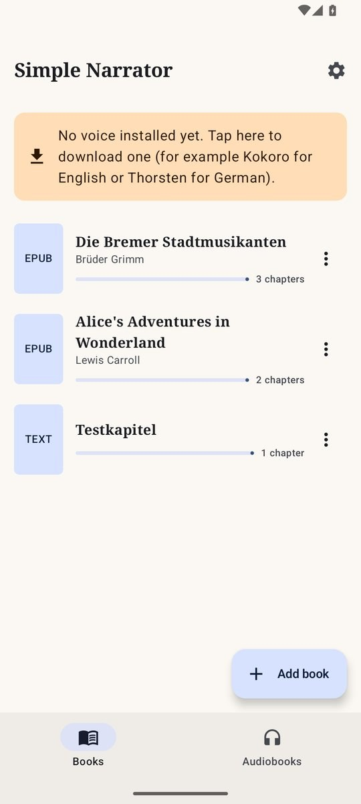
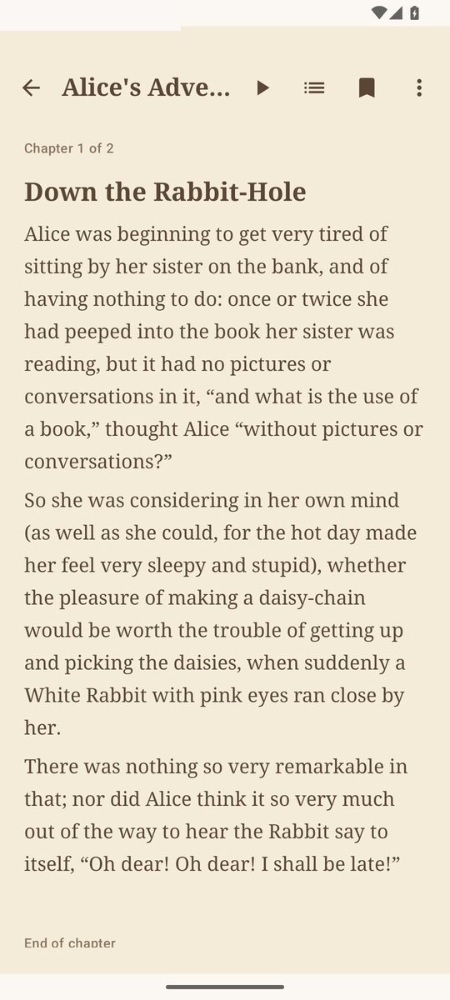
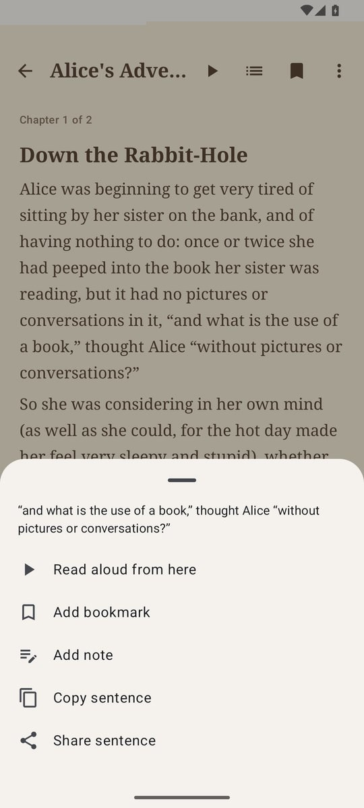
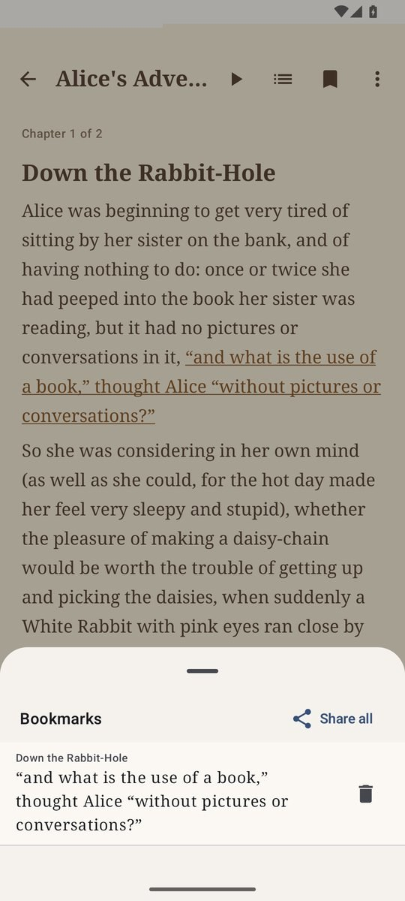
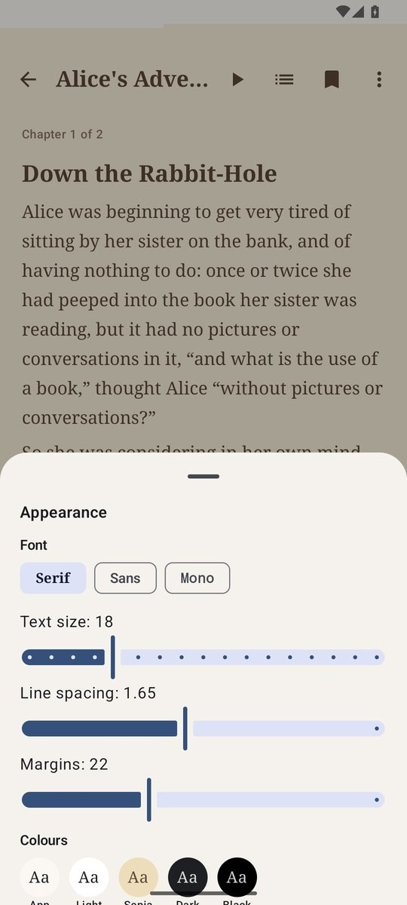
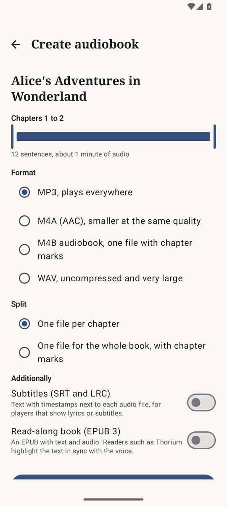
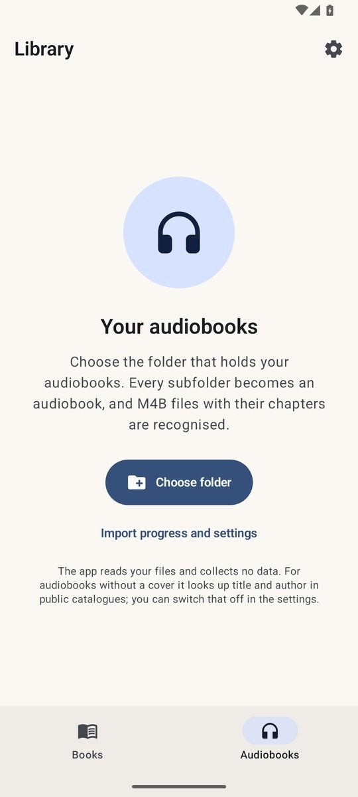
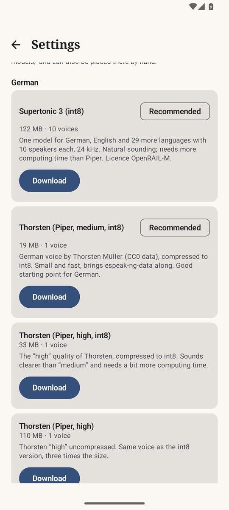

# Simple Narrator

Simple Narrator reads EPUB, PDF and text files aloud on an Android phone and plays audiobooks. The voices
(Supertonic, Kokoro, Piper and Kitten, run through sherpa-onnx with ONNX Runtime and espeak-ng) work
entirely on the device: once a voice is installed, reading needs no server and no internet connection.
Whole books can be exported as audiobooks with chapter marks and then played in the app's own audiobook
area. The app is available in English and German.

[Deutsche Fassung](README.de.md)

<p>




</p>
<p>




</p>

## Features

The app has two areas, switched with the bar at the bottom: **Books** (reading aloud) and **Audiobooks**
(a full audiobook player based on Simple Audiobooks).

| Area | Function |
|---|---|
| Import | EPUB (2 and 3, cover, table of contents), PDF (text layer, bookmarks become chapters, running headers, footers and page numbers are removed, hyphenation is joined), TXT and Markdown, pasted text, web articles (the main text is extracted), Project Gutenberg search. “Open with” and “Share” from any app, “Read aloud” in the text selection menu. |
| Scanned PDFs | PDFs whose pages have no text layer are recognised on the device with Tesseract (German and English, language data about 6 MB, loaded once). The recognition runs in the background with progress in the notification and in the library. |
| Project Gutenberg | Search by title or author with a language filter, download with one tap. If gutendex.com does not answer within 15 seconds, the app searches the catalogue of gutenberg.org instead. Chapters follow the table of contents of the book, also inside one long file; the Gutenberg header and licence text are left out. |
| Reading | Chapter view and chapter list, search in the book, bookmarks and notes (long-press a sentence; all notes can be shared as text), appearance: font, size, line spacing, margins and colours (app, light, sepia, dark, black). The reading position is saved. |
| Reading aloud | **Tap a sentence to start reading exactly there.** The current sentence and the spoken word are highlighted and the view follows. Synthesis runs six sentences ahead. Sentence and chapter back and forward, playback speed 0.8 to 2.0× (the pitch stays), sleep timer (minutes or end of chapter) that fades out and can be extended by shaking, one sentence back after a pause of more than 5 minutes, study mode that stops after every sentence, “bookmark this sentence”. Runs in the background with a notification, lock screen controls and Bluetooth buttons. |
| Voices | German and English, detected **for every paragraph**, so mixed books switch voices. Supertonic 3 (one model for both languages, 10 speakers), Piper voices in int8 (Thorsten, Thorsten Emotional, Kerstin, Ramona, Eva K, Karlsson, Pavoque; Lessac, Ryan, Amy, Alan, Cori), Kokoro 1.0 with 28 English voices, Kokoro 0.19, Kitten nano and the German Kokoro voice “Martin”. If the chosen voice is missing, another installed voice of the same language reads. |
| Direct speech | Optional second voice for text in quotation marks („…“, »…«, “…”), across sentence boundaries. |
| Voice mixing | Two Kokoro voices can be mixed into a new one (share adjustable). |
| Pronunciation | Rules with `word=pronunciation`, regular expressions (`*regex=replacement`), `[skip]` and `[pause:800]`; import from Librera Reader and @Voice Aloud Reader. |
| Pauses and cache | Adjustable pauses after sentences, paragraphs and between chapters. The silence the voice models put around every sentence is cut off, so the pauses are exactly as set (Supertonic alone adds about half a second before every sentence). Generated sentences are kept in a cache of adjustable size and reused when going back or exporting. |
| Natural reading | Short sentences and replies stay separate, so each gets its pause; a speech tag stays with its quote (“Let me in!” I interrupted.). An ellipsis inside a sentence becomes a short hesitation, a scene break (“* * *”, a horizontal rule) a longer pause. Stutters (“W-what”), dashes without spaces (“was--how”) and interjections that espeak-ng would spell out (“Shhh”, “Hmph”, “Pst”, “Brr”) are rewritten into forms it speaks. |
| Text repair | Broken encoding (“don’t”, “ä”) and ligatures (fi, fl, ff) are repaired on import. Plain-text books from Project Gutenberg lose their header and licence, a printed table of contents is skipped, and chapters are found at “CHAPTER I.”, at standalone numerals and at repeated capital-letter lines. EPUBs skip printed contents pages made of links. PDFs join words hyphenated across a page break and drop footnote numbers glued to words. |
| Audiobook export | Whole book or a range of chapters as **MP3**, M4A, **M4B** or WAV, **one file per chapter** or **one file for the whole book**. Chapter marks and tags are written into the files (ID3 chapters for MP3, Nero and QuickTime chapters for M4A/M4B, title, author, album, cover). Optional subtitles (SRT, LRC) and a read-along EPUB 3 with Media Overlays. The export runs in the background, survives closing the app and continues after an interruption with the chapters already done. Result in `Downloads/Simple Narrator/<book>/`. |
| After the export | “Add to audiobooks” adds the export folder to the audiobook library, “Upload to Audiobookshelf” sends the files to an Audiobookshelf server. |
| Audiobooks | Library folders, chapters from M4B/MP3/Ogg/Opus/FLAC and cue sheets, sleep timer, covers from the internet (can be switched off), statistics, bookmarks, backup export and import (also from Simple Audiobooks), Android Auto. |
| System voice | Simple Narrator can be chosen as the text-to-speech engine of Android; other apps then use the voices, rules and text preparation set up here. |
| App language | English or German, independent of the system language (Settings > App language; from Android 13 also in the system settings of the app). |
| Appearance | Light, dark or as the system. Colour schemes: night blue and gold, petrol, violet, forest green, raspberry, graphite and ice blue, sky blue, sage and cream, amber, or the colours of the wallpaper (Android 12 and later). “Pure black” for OLED screens. Applies to both areas and is part of the audiobook backup. |

## Getting started

1. Install the APK from the [releases](../../releases) (arm64 devices, Android 8 or newer).
2. Open Settings and download a voice. Recommended: **Supertonic 3** for German and English, or the small
   **Thorsten (Piper, medium, int8)** for German and **Kokoro 1.0 (int8)** for English.
3. Add a book with “Add book” (file, pasted text, web article or Project Gutenberg) or share a file or a link
   from another app. Tap any sentence to start reading.

## Building

1. Android Studio (Ladybug or newer): **File > Open** and choose the project folder (the one that
   contains `settings.gradle.kts`). The Gradle wrapper is included; the first sync downloads Gradle 8.9
   and all libraries.
2. sherpa-onnx comes from JitPack (`com.github.k2-fsa.sherpa-onnx:sherpa-onnx:v1.13.8`, the repository is
   listed in `settings.gradle.kts`). Version 1.13.8 already supports Supertonic, Kokoro, Kitten and Piper.
3. Command line:
   - `./gradlew :app:assembleDebug` builds `app.simplenarrator.debug` for arm64 and x86_64, so it also
     runs in the Android emulator and can be installed next to the release build.
   - `./gradlew :app:assembleRelease` builds the release APK for arm64 with R8. It is signed when the
     project folder contains a `keystore.properties` with `storeFile`, `storePassword`, `keyAlias` and
     `keyPassword`; without it the APK stays unsigned. Both files are excluded from git.
   - `-PonlyAbi=x86_64` builds for one ABI only, for example a smaller APK for an emulator with little
     space, or a release build that runs natively in the x86_64 emulator.
   - `./gradlew :app:testDebugUnitTest` runs the unit tests.

## German with Kokoro

**Recommended for German are Supertonic 3 and Thorsten (Piper).** The Piper voices come ready converted
from the sherpa-onnx release (including `espeak-ng-data`); the int8 versions are about a third of the size
of the full ones. Piper delivers 22.05 kHz; when several voices are exported into one file, the audio is
resampled to the rate of the first voice.

Kokoro itself has **no official German**; the Kokoro finetunes are included as an additional option:

- **"Martin" (kikiri-tts, ONNX export by Godelaune)** can be installed directly in the app. The
  repository contains `kokoro-martin.onnx` and `voices-martin.npz` (kokoro-onnx format), but neither
  `tokens.txt` nor the metadata that sherpa-onnx expects. `tts/KokoroConvert.kt` handles this
  automatically after the download: `voices-martin.npz` becomes `voices.bin`, `tokens.txt` is written
  from the standard Kokoro vocabulary, and the metadata (`sample_rate=24000, n_speakers, has_espeak=1,
  voice=de, style_dim=510,1,256`) is appended to the ONNX file as further `metadata_props` without
  rewriting the 326 MB. The same happens for files copied by hand to `models/kokoro-de-martin/`. Tested
  with this model in the emulator.
- **Thorsten-Voice/Kokoro** (and Kokoro Hessian) is published as a PyTorch checkpoint. Export it to ONNX
  once, save the voice pack as `.npz` and place both in `models/kokoro-de-thorsten/` (`model.onnx` and
  `voices-thorsten.npz`). The app then converts them the same way.

## Preparing text for speech

`speech/Normalizer.kt` writes out what a voice would otherwise read wrongly or not at all. The display
keeps the original text; only the spoken text is prepared. This can be switched off in the settings.

| Input (German) | Spoken |
|---|---|
| am 3. Mai 2024 um 14:30 Uhr | am dritten Mai zweitausendvierundzwanzig um vierzehn Uhr dreißig |
| 12,50 € · 3,5 Mio. Euro | zwölf Euro fünfzig · drei Komma fünf Millionen Euro |
| z. B., d. h., usw., Dr., Hauptstr. 5 | zum Beispiel, das heißt, und so weiter, Doktor, Hauptstraße fünf |
| unter Ludwig XIV. · im 19. Jahrhundert | unter Ludwig dem Vierzehnten · im neunzehnten Jahrhundert |
| 1990 fiel die Mauer · 1500 Menschen | neunzehnhundertneunzig … · tausendfünfhundert Menschen |
| 5 km in 20 min · 85 m² · −5 °C · 3,5 % | fünf Kilometer in zwanzig Minuten · … Quadratmeter · minus fünf Grad Celsius · … Prozent |
| footnotes [12], ¹, URLs | removed, or "beispiel Punkt de" |

English accordingly: `$5.99` becomes five dollars and ninety-nine cents, `Henry VIII` becomes Henry the
Eighth, `1990s` becomes nineteen nineties, `3:30 pm` becomes three thirty p m.

Rules never change a number, can be tested completely and cost the phone neither memory nor time. Whatever
no rule recognises safely goes to espeak-ng unchanged. Limits: the German case is guessed from the
preceding word, the accusative is not recognised ("Er hatte 1 Hund" becomes "ein Hund"), and whether
"1990" is a year or a quantity is decided by a following capitalised noun.

## Tests and verification

`./gradlew :app:testDebugUnitTest` runs about 250 unit tests: number words, normaliser, segmenter, import
(TXT, EPUB), speech rules and rule import, direct speech, the speech pipeline, the system voice helpers,
MP4 and ID3 chapter writing (read back with the chapter parsers of the audiobook area), subtitles, the
read-along EPUB, voice mixing, MP3 encoding, web article extraction, Project Gutenberg with the catalogue
fallback and Audiobookshelf (against a local test server), splitting Gutenberg EPUBs at their table of
contents, the detection of scanned PDF pages, and the tests of the audiobook area including its colour
schemes (contrast checks for every scheme).

Checked in the Android 15 emulator:

- Reading aloud with sentence and word highlighting with Supertonic 3, Piper (Thorsten, Thorsten Emotional),
  Kokoro 1.0 (also with a voice mixed from af_heart and am_adam), Kitten nano and the Kokoro “Martin”
  conversion; direct speech with a second voice.
- Export per chapter as MP3 with subtitles and read-along EPUB, export as M4B with chapters (checked with
  ffprobe), “Add to audiobooks” with playback of the exported book, both players side by side.
- The system voice in the Android settings, text recognition of a scanned PDF (word for word), the R8
  release build (built for x86_64) with reading, PDF import, text recognition and MP3 export.
- Project Gutenberg search through gutendex.com and through the catalogue fallback, downloads with their
  chapters and without the Gutenberg texts, web articles with their sections as chapters, plain-text books
  in Gutenberg layout.
- Pauses measured on the generated audio: the models put a median of 300 ms (Kitten) and 550 ms
  (Supertonic) of silence before a sentence; it is cut to 30 ms, and a sentence change takes the set pause
  plus a margin of 60 ms. An ellipsis inside a sentence gives a pause of 440 ms, a scene break 1.95 s.
- The colour schemes with pure black and the screens of both areas in English and German.

The spellings for interjections were chosen by phonemising the candidates with espeak-ng; how they sound
was not listened to.

Not checked yet: Audiobookshelf against a real server, the arm64 release build on a phone (the ARM
translation of the x86 emulator crashes inside ONNX Runtime), the language switch below Android 13 and
Android Auto.

## Architecture

```
data/        Book/Chapter/Paragraph/Sentence, BookRepository, Annotations (bookmarks, notes), SettingsStore
parser/      EpubParser (jsoup), PdfParser (PDFBox-Android), TxtParser, TextCleaner, Segmenter, LanguageDetector
input/       WebArticle, Gutenberg, IncomingShare, Ocr and OcrImportWorker (Tesseract)
speech/      Normalizer, number words, SpeechRules (pronunciation rules), RuleImport, Dialogue (direct speech)
tts/         VoicePacks (catalogue), ModelManager, SherpaTtsEngine, TtsManager, SpeechPipeline, SentenceAudio
             (cache), Blends and VoiceBlend (voice mixing), SystemTtsService (Android TTS engine)
playback/    ReadAloudService (MediaSessionService with ExoPlayer), PlaybackController (UI side)
export/      ExportWorker (WorkManager), encoders (MediaCodec AAC, jump3r MP3), Mp4Tags, Id3Tag, Subtitles,
             SyncEpub, Audiobookshelf, MediaStoreSaver
audiobooks/  the audiobook area (based on Simple Audiobooks 1.5.0): library, scanner, chapter parsers, player
             service (MediaLibraryService), screens
ui/          main frame with both areas, library, reader, search, export, settings, Gutenberg, dialogs
util/        AppLanguage (language of the user interface)
```

Reading pipeline: sentence, then rules and text preparation, then sherpa-onnx (narrator or dialogue voice),
then a WAV file in the cache, then a `MediaItem` for ExoPlayer.

## Ideas for later

- Word timings from the model itself once sherpa-onnx provides them.
- Export directly into an Audiobookshelf library folder through SAF or SMB.
- Widget or quick settings tile “Continue reading”.

## License

Simple Narrator is free software under the GNU General Public License, version 3 or later
(`GPL-3.0-or-later`), see [LICENSE](LICENSE). The audiobook area is based on Simple Audiobooks, which is
under the same license. Several ideas for the text preparation (keeping quotes with their speech tags,
silence for scene breaks, printed contents lists, chapter detection in plain text, Gutenberg header and
licence) come from [cedar-server](https://github.com/mlevinmail/cedar-server) (MIT) and were rewritten in Kotlin.

Libraries: AndroidX, Jetpack Compose and Media3 (Apache 2.0), Kotlin and kotlinx (Apache 2.0),
sherpa-onnx (Apache 2.0, contains ONNX Runtime under MIT and espeak-ng under GPL-3.0-or-later),
PDFBox-Android (Apache 2.0), jsoup (MIT), Apache Commons Compress (Apache 2.0), jump3r (LGPL 2.1 or
later), OkHttp (Apache 2.0), Coil (Apache 2.0), Tesseract4Android (Apache 2.0, contains Tesseract under
Apache 2.0 and Leptonica under a BSD-style license). The language data for the text recognition comes from
tessdata_fast (Apache 2.0) and is loaded in the app.

The voice models are not part of this repository. They are downloaded from their sources and keep their
own licenses (see the notes in the app; Supertonic is under OpenRAIL-M).
